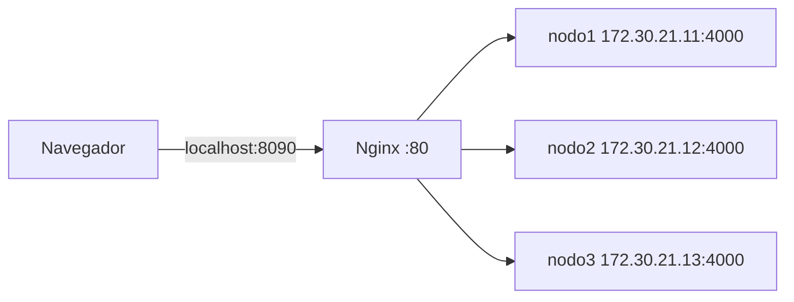

# Comedor Rosita

Proyecto de cátedra, **Fase 3**: clúster de tres nodos Express/TypeScript con balanceo Round Robin y tolerancia a fallos mediante Nginx.



## Ejecutar

Abre Docker Desktop y ejecuta desde la raíz:

```powershell
Copy-Item .env.example .env # Solo si todavía no existe
# Configura ADMIN_TOKEN en .env con tu propio valor.
docker compose up -d --build --wait
docker compose ps
```

Abre [el sitio](http://localhost:8090) o [la comprobación de salud](http://localhost:8090/health). Cada nodo sirve tanto los archivos de `public/` como la API. La imagen define un HEALTHCHECK; Nginx espera a que los tres nodos estén saludables. El token predeterminado del laboratorio es `token-secreto-rosita`; el valor de `.env` tiene prioridad.

## Balanceo y failover

```powershell
1..6 | ForEach-Object { curl.exe -sS http://localhost:8090/health; echo "" }
docker compose stop nodo2
1..6 | ForEach-Object { curl.exe -sS -w " HTTP %{http_code}\n" http://localhost:8090/health; echo "" }
docker compose start nodo2
Start-Sleep -Seconds 11
1..6 | ForEach-Object { curl.exe -sS http://localhost:8090/health; echo "" }
```

El campo `nodo` identifica al servidor que respondió. Con los tres activos deben aparecer `nodo1`, `nodo2` y `nodo3`. Con `nodo2` detenido, las respuestas deben ser HTTP 200 desde los otros dos. Nginx reintenta ante errores de conexión, timeout y HTTP 502/503, con `max_fails=2` y `fail_timeout=10s`.

Las evidencias y el registro de la prueba están en [docs/evidencias](docs/evidencias/). Para detener el clúster: `docker compose down`.

## Alcance del laboratorio

El balanceo y el failover demuestran disponibilidad HTTP. El inventario y los pedidos se almacenan **en la memoria de cada nodo**, son independientes y se pierden al reiniciar el proceso. Para usar pedidos reales entre réplicas hace falta una base de datos compartida; esta fase no implementa replicación de datos.

## API y desarrollo

- `GET /api/menu`: menú e inventario del nodo.
- `POST /api/pedidos`: registra un pedido en el nodo que lo atiende.
- `GET /api/pedidos`: requiere `Authorization: Bearer <ADMIN_TOKEN>`.
- `GET /health`: estado, servicio, nodo y fecha.

```powershell
npm ci
npm run typecheck
npm run build
npm run dev
```

En desarrollo abre http://127.0.0.1:4000.

## Fase 2: Apache y HTTPS

La configuración anterior se conserva en `docker-compose.fase2.yml`. Las instrucciones completas están en [docs/FASE_2.md](docs/FASE_2.md); ejecuta sus comandos desde la raíz del proyecto. Para iniciar aquella versión:

```powershell
docker compose -f docker-compose.fase2.yml up -d --build
# Con certificados locales ya preparados:
docker compose -f docker-compose.fase2.yml -f docker-compose.https.yml up -d --build
```
